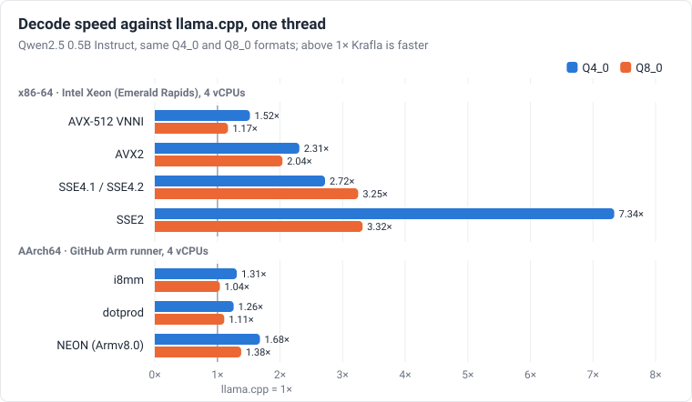

# Comparison with llama.cpp

This page compares Krafla and [llama.cpp](https://github.com/ggml-org/llama.cpp)
running the same model, with the same weight formats, on one machine at four
x86 instruction-set levels. The [GitHub runners](#github-runners) section
repeats the comparison on an x86-64 machine without AVX-512 and at three
levels on AArch64. `scripts/compare_llamacpp.sh` reproduces each run.



The chart shows the one-thread decode ratios of the tables below
(`scripts/sync_docs.py` draws it from them).

## Setup

- **Machine:** 4 vCPUs of an Intel Xeon at 2.10 GHz (Emerald Rapids) with
  AVX-512 VNNI and AMX, 15 GB of RAM; GCC 13.3 for both runtimes. llama.cpp's
  native build uses AMX tiles for prefill on this CPU (see below); Krafla has
  no AMX kernels.
- **llama.cpp:** release b11835 (commit `f64a498`), CPU backend, built four
  times:

  | Build | Options |
  |-------|---------|
  | AVX-512 VNNI | `GGML_NATIVE=ON` |
  | AVX2 | `GGML_NATIVE=OFF`, AVX, AVX2, BMI2, FMA, F16C; no AVX-512 |
  | SSE4.2 | `GGML_NATIVE=OFF`, SSE4.2 only |
  | SSE2 | `GGML_NATIVE=OFF`, every x86 extension off |

  Krafla builds for `avx512vnni`, `avx2`, `sse41` and `sse2`, with
  `THREADS=pthread`. The SSE4.2 llama.cpp build is compared with Krafla's
  SSE4.1 build, because SSE4.2 adds only string and CRC instructions.
- **Model:** Qwen2.5 0.5B Instruct. llama.cpp quantizes the official
  `qwen2.5-0.5b-instruct-fp16.gguf` with `llama-quantize --pure`, so that
  every matrix, embeddings and classifier included, is Q8_0 or Q4_0, as in
  Krafla's `--wtype q8` and `--wtype q4` files. Krafla's files have f16 scales
  and take 500 MiB (Q8_0) and 265 MiB (Q4_0), against 644 and 343 MiB for
  llama.cpp's, so they are 22–23% smaller. Qwen2.5 0.5B ties its classifier to
  the embedding, and the GGUF files store it a second time; each runtime reads
  one copy per token.
- **Speed:** prefill of 128 tokens, then 128 tokens decoded after them
  (`ml_bench -n 128`; `llama-bench -p 128 -n 0` and `-p 0 -n 128 -d 128`),
  mean of 3 runs, tokens per second.
- **Quality:** wikitext-2 test set, 4 chunks of 512 tokens, the second half of
  each chunk scored: `llama-perplexity -c 512 --chunks 4` and
  `tools/perplexity.py --llama-cpp`, which chunks and scores the same way.

## Speed

Speeds are in tokens per second. The decode ratio is Krafla's decode speed
divided by llama.cpp's.

| ISA level | Weights | Threads | Krafla prefill | llama.cpp prefill | Krafla decode | llama.cpp decode | Decode ratio |
|-----------|---------|--------:|---------------:|------------------:|--------------:|-----------------:|-------------:|
| AVX-512 VNNI | Q8_0 | 1 | 318.5 | 368.5 | 24.0 | 20.5 | 1.17× |
| AVX-512 VNNI | Q8_0 | 4 | 870.8 | 935.1 | 72.8 | 60.7 | 1.20× |
| AVX-512 VNNI | Q4_0 | 1 | 331.4 | 339.8 | 44.0 | 29.0 | 1.52× |
| AVX-512 VNNI | Q4_0 | 4 | 1118.9 | 1303.9 | 133.4 | 95.7 | 1.39× |
| AVX2 | Q8_0 | 1 | 95.9 | 70.6 | 22.4 | 11.0 | 2.04× |
| AVX2 | Q8_0 | 4 | 265.2 | 189.5 | 72.4 | 38.2 | 1.90× |
| AVX2 | Q4_0 | 1 | 182.6 | 82.7 | 41.6 | 18.0 | 2.31× |
| AVX2 | Q4_0 | 4 | 541.9 | 309.8 | 128.6 | 60.6 | 2.12× |
| SSE4.1 / SSE4.2 | Q8_0 | 1 | 47.7 | 13.9 | 20.5 | 6.3 | 3.25× |
| SSE4.1 / SSE4.2 | Q8_0 | 4 | 161.0 | 57.8 | 59.4 | 22.7 | 2.62× |
| SSE4.1 / SSE4.2 | Q4_0 | 1 | 64.9 | 26.9 | 33.4 | 12.3 | 2.72× |
| SSE4.1 / SSE4.2 | Q4_0 | 4 | 226.0 | 111.5 | 90.2 | 42.1 | 2.14× |
| SSE2 | Q8_0 | 1 | 39.6 | 12.8 | 20.6 | 6.2 | 3.32× |
| SSE2 | Q8_0 | 4 | 126.0 | 49.8 | 56.4 | 21.2 | 2.66× |
| SSE2 | Q4_0 | 1 | 36.7 | 5.7 | 25.7 | 3.5 | 7.34× |
| SSE2 | Q4_0 | 4 | 124.4 | 21.8 | 77.3 | 12.7 | 6.09× |

Measured with Krafla at commit `1c6db5a` (the 0.4.0 code). Against the
previous run (`0cb4d16`), AVX-512 VNNI prefill went from 221 to 319 tok/s
(Q8_0, 1 thread) and from 890 to 1119 (Q4_0, 4 threads), and decode from 41.6
to 44.0 (Q4_0, 1 thread). Before 0.4.0, when Krafla's prefill ran in steps of
32 tokens instead of 128, llama.cpp's Q8_0 prefill with AVX-512 VNNI led by
1.6–1.8×. Before 0.4.0's signed-nibble kernels, llama.cpp's dotprod Q4_0
prefill on the Arm runner led by 1.34–1.37×. llama.cpp's own numbers move by
a few percent between runs on the same kind of machine, so compare rows of one
run.

- **Decode** with Krafla is at least as fast as with llama.cpp at every ISA
  level measured: 1.2–1.5× as fast with AVX-512 VNNI, 1.9–2.3× with AVX2, and
  2.1–7.3× on the SSE builds.
- **Prefill** with AVX-512 VNNI is faster with the native llama.cpp build: by
  1.07–1.16× for Q8_0 and by up to 1.17× for Q4_0. From AVX2 down, Krafla
  prefills faster (1.4–6.4×).

The native llama.cpp build gets its prefill speed from AMX, not from AVX-512
VNNI: by default it repacks its weights for AMX tiles. With repacking turned
off (`llama-bench --repack 0`, on the same machine in a later run), it
prefills Q8_0 at 93 tok/s on one thread and 318 tok/s on four, and Q4_0 at 83
and 320 tok/s. That is about a third of Krafla's speed in the AVX-512 VNNI
rows.

An AMX kernel for Krafla's packed layout is kept on the `exp/amx` branch and
is not part of the build. Each 32-weight block has its own scale, so the
kernel has to store each 16×16 tile product and rescale it with AVX-512, in
the same order as the matrix-vector kernel; this keeps prefill bit-identical
to decoding. Microbenchmarks on this CPU show where the time goes. They run
on one core with the weights in L2, and the times are per block of 16 tokens
× 16 rows:

| Work per block | ns |
|---|---:|
| tile loads and `tdpbsud` alone | 10.9 |
| the same plus zeroing and storing the sum tile | 16.4 |
| rescaling alone (convert, multiply, FMA per token) | 12.8 |
| the same with the `offset * sum(x)` subtraction | 17.9 |
| tiles and rescaling together | 34–37 |

The tile instructions and the AVX-512 rescaling do not overlap: their times
add up. The second version of the kernel removes the subtraction, as the
microbenchmark suggested: Q8 sum tiles start at `-128 * sum(x)`, loaded from a
buffer built once per tile of tokens, and Q4 nibbles are widened to `q - 8`
for `tdpbssd`. On the kernels alone, Q8_0 got 5–13% faster than the first
version (1.2–1.4× as fast as the AVX-512 VNNI kernel) and Q4_0 20–43% faster
(1.0–1.2× as fast).

On Qwen2.5 0.5B, prefill with this kernel is level with the AVX-512 VNNI
build on one thread and 15–20% slower on four threads, so AMX stays out of
the build.

## GitHub runners

The `llama.cpp comparison` workflow (`.github/workflows/compare.yml`, started
by hand) builds both runtimes and runs `scripts/compare_llamacpp.sh` on two
GitHub runners: `ubuntu-24.04` (x86-64, 4 vCPUs with AVX2 but no AVX-512) and
`ubuntu-24.04-arm` (AArch64, 4 vCPUs with dotprod and i8mm). On AArch64 the
llama.cpp builds are the native one (against Krafla's best build,
`neon_i8mm`), `armv8.2-a+dotprod` and `armv8-a`. The tables below come from
one run, with Krafla `1c6db5a` (the 0.4.0 code) and llama.cpp b11835.

### x86-64 (AVX2)

| ISA level | Weights | Threads | Krafla prefill | llama.cpp prefill | Krafla decode | llama.cpp decode | Decode ratio |
|-----------|---------|--------:|---------------:|------------------:|--------------:|-----------------:|-------------:|
| AVX2 | Q8_0 | 1 | 133.4 | 94.4 | 38.8 | 29.7 | 1.31× |
| AVX2 | Q8_0 | 4 | 261.3 | 180.1 | 62.5 | 61.0 | 1.02× |
| AVX2 | Q4_0 | 1 | 216.3 | 114.7 | 75.9 | 43.1 | 1.76× |
| AVX2 | Q4_0 | 4 | 435.1 | 238.8 | 109.4 | 85.4 | 1.28× |
| SSE4.1 / SSE4.2 | Q8_0 | 1 | 60.8 | 16.7 | 34.2 | 9.6 | 3.56× |
| SSE4.1 / SSE4.2 | Q8_0 | 4 | 120.4 | 34.9 | 58.7 | 19.6 | 2.99× |
| SSE4.1 / SSE4.2 | Q4_0 | 1 | 90.2 | 32.0 | 40.8 | 15.9 | 2.57× |
| SSE4.1 / SSE4.2 | Q4_0 | 4 | 182.1 | 66.8 | 78.7 | 32.0 | 2.46× |
| SSE2 | Q8_0 | 1 | 47.4 | 16.1 | 26.8 | 9.2 | 2.91× |
| SSE2 | Q8_0 | 4 | 94.9 | 34.3 | 50.1 | 19.8 | 2.53× |
| SSE2 | Q4_0 | 1 | 49.7 | 5.1 | 33.5 | 3.3 | 10.15× |
| SSE2 | Q4_0 | 4 | 101.3 | 10.2 | 64.7 | 6.7 | 9.66× |

### AArch64

| ISA level | Weights | Threads | Krafla prefill | llama.cpp prefill | Krafla decode | llama.cpp decode | Decode ratio |
|-----------|---------|--------:|---------------:|------------------:|--------------:|-----------------:|-------------:|
| i8mm (native) | Q8_0 | 1 | 183.0 | 127.4 | 35.6 | 34.2 | 1.04× |
| i8mm (native) | Q8_0 | 4 | 714.6 | 430.8 | 110.1 | 104.0 | 1.06× |
| i8mm (native) | Q4_0 | 1 | 173.1 | 148.3 | 50.8 | 38.7 | 1.31× |
| i8mm (native) | Q4_0 | 4 | 682.5 | 484.0 | 143.2 | 114.6 | 1.25× |
| dotprod | Q8_0 | 1 | 148.3 | 129.7 | 35.7 | 32.1 | 1.11× |
| dotprod | Q8_0 | 4 | 570.5 | 496.6 | 107.3 | 100.7 | 1.07× |
| dotprod | Q4_0 | 1 | 138.1 | 156.6 | 50.8 | 40.2 | 1.26× |
| dotprod | Q4_0 | 4 | 535.0 | 590.8 | 143.2 | 118.9 | 1.20× |
| NEON (Armv8.0) | Q8_0 | 1 | 36.5 | 26.7 | 21.7 | 15.7 | 1.38× |
| NEON (Armv8.0) | Q8_0 | 4 | 142.7 | 105.7 | 66.8 | 50.7 | 1.32× |
| NEON (Armv8.0) | Q4_0 | 1 | 41.1 | 24.3 | 26.5 | 15.8 | 1.68× |
| NEON (Armv8.0) | Q4_0 | 4 | 160.8 | 96.1 | 81.2 | 53.3 | 1.52× |

On x86-64 without AVX-512, Krafla is at least as fast as llama.cpp at every
ISA level measured. It decodes 1.0–1.8× as fast with AVX2 and 2.5–10× as fast
on the SSE builds, and it prefills 1.4–1.9× as fast with AVX2 and 2.7–10× as
fast on the SSE builds.

On AArch64 with dotprod and i8mm, Krafla decodes 1.04–1.11× as fast as
llama.cpp for Q8_0 and 1.20–1.31× as fast for Q4_0. With plain ARMv8.0 NEON,
it is 1.3–1.7× as fast in both prefill and decode. With i8mm it prefills
1.4–1.7× as fast for Q8_0 and 1.2–1.4× as fast for Q4_0, and with dotprod
1.14× as fast for Q8_0. Only dotprod Q4_0 prefill is faster with llama.cpp,
by 1.10–1.13×, because of llama.cpp's repacked Q4_0 kernels.

## Quality

| Runtime | Weights | Perplexity |
|---------|---------|-----------:|
| llama.cpp | F16 | 13.34 |
| llama.cpp | Q8_0 | 13.44 |
| Krafla | Q8_0 | 13.32 |
| llama.cpp | Q4_0 | 15.86 |
| Krafla | Q4_0 | 15.14 |

The results are about the same on all three machines: Krafla's Q8_0 scores
13.32–13.35 against 13.34 for llama.cpp's F16, and its Q4_0 scores
15.09–15.14 against 15.82–15.93 for llama.cpp's Q4_0.

The two runtimes tokenize this text identically (no BOS for Qwen2.5). Krafla's
Q8_0 matches F16. Its Q4_0 is closer to F16 than llama.cpp's (15.14 against
15.86) because `tools/convert.py` fits each block's scale (see
[Q8, Q4, or mixed?](user-guide.md#q8-q4-or-mixed)), while `llama-quantize`
without an importance matrix maps the largest weight to -8. llama.cpp's
default Q4_0 (without `--pure`) keeps the classifier in a higher-precision
type, which Krafla can do with `--q8 cls`. Neither row uses an importance
matrix; with one collected on the wikitext-2 training set, Krafla's Q4_0
scores 14.52 ([importance matrix](user-guide.md#q8-q4-or-mixed)).

## Reproducing

```sh
git clone --depth 1 --branch b11835 https://github.com/ggml-org/llama.cpp
cd llama.cpp
cmake -S . -B build-native -DCMAKE_BUILD_TYPE=Release -DGGML_NATIVE=ON
cmake --build build-native -j --target llama-bench llama-perplexity llama-quantize
# build-avx2, build-sse42, build-base: -DGGML_NATIVE=OFF with the options above
cd -
scripts/compare_llamacpp.sh ../llama.cpp ./Qwen2.5-0.5B-Instruct \
    qwen2.5-0.5b-instruct-fp16.gguf wikitext-2-test.txt build/compare
```

The script converts the model for Krafla, quantizes the GGUF, runs both
benchmarks and writes `build/compare/results.md`. It picks the ISA levels
from the host: on AArch64 the llama.cpp build directories are `build-native`,
`build-dotprod` (`-DGGML_NATIVE=OFF -DGGML_CPU_ARM_ARCH=armv8.2-a+dotprod`) and
`build-base` (`armv8-a`). A missing llama.cpp build directory skips that row;
`THREADS`, `TOKENS`, `REPS`, `CTX` and `CHUNKS` change the settings.

On GitHub, run the `llama.cpp comparison` workflow (Actions tab, Run
workflow); it reports each machine's table in the run summary, as an artifact
and as an annotation.
