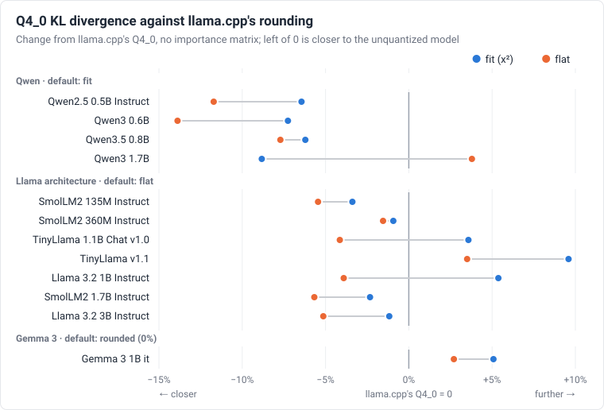

# Q4_0 block scales

Krafla stores Q4 weights in llama.cpp's Q4_0 layout: blocks of 32 weights, one
f16 scale `d` per block, each weight `d * (q - 8)` with `q` from 0 to 15. The
format leaves the choice of `d` to the quantizer. This page measures how
Krafla's choice compares with llama.cpp's on the same tensors.

## Summary

- **Without an importance matrix**, `tools/convert.py` picks the rule by
  architecture, and each one brings the model closer to the unquantized one
  than llama.cpp's Q4_0:
  - **Qwen** (four models): the fit, with KL divergence 6–9% lower.
  - **Llama architecture** (Llama 3.2, TinyLlama and SmolLM2; seven models):
    the fit weighted as llama.cpp weights its importance search
    (`--q4-rule flat`). KL divergence is 1.5–5.6% lower on six of the seven,
    and lower than the plain fit's on all seven.
  - **Gemma 3**: llama.cpp's rounding, which gives the same bytes.
- **With an importance matrix**, llama.cpp's own search does as well as
  Krafla's fit or better on five of the seven models tried.
- **Earlier figures were too large.** The comparison page gave Qwen2.5 0.5B a
  Q4_0 perplexity of 15.14 against 15.86 for llama.cpp. That came from 4
  chunks, about 1,000 scored tokens. On 32 chunks the gap narrows to 15.88
  against 16.11.
- **Format matters more than scales.** Q4_K_M, at 14–42% more bytes, has
  1.3–5 times less KL divergence than the best Q4_0 of each model (2.4–6.5
  times with an importance matrix).



The chart shows the KL divergence tables below, without an importance matrix
(`scripts/sync_docs.py` draws it from them). Each row is one model; the
farther left a dot, the closer that rule brings the model to the unquantized
one. The group labels give the rule `tools/convert.py` uses by default.

## The rules

- **Rounded** (llama.cpp's `quantize_row_q4_0_ref`, used by `llama-quantize`
  without an importance matrix):
  - `d` is the block's largest-magnitude weight divided by -8.
  - Each weight is rounded to the nearest level.
  - `tools/convert.py --q4-rule round` produces the same bytes.
- **Fitted** (`--q4-rule fit`, Krafla's default except for the Llama
  architecture and Gemma 3, `tools/mlb.py`):
  - For 13 candidates, the largest weight is mapped to level `-(8 + s)`, with
    `s` from -2.0 to 0.4 in steps of 0.2.
  - Each candidate's `d` is fitted by least squares weighted by `x²`, and the
    candidate with the least weighted error is kept.
- **Flat** (`--q4-rule flat`, the default for `model_type` `llama`): the same
  13 candidates, with the error weighted by `sqrt(s2 + x²)`, where `s2` is the
  row's mean `x²`. This is llama.cpp's weighting below with every channel
  equally important. The embedding and classifier keep the `x²` fit.
- **llama.cpp search** (`llama-quantize --imatrix`):
  - Same idea, with 19 candidates from -7.1 to -8.9 in steps of 0.1.
  - The error is weighted by `imp * sqrt(s2 + x²)`, where `imp` is the
    channel's mean squared input and `s2` is the row's mean `x²`.
- **Krafla with an importance matrix** (`convert.py --imatrix`) uses that
  weighting with its own 13 candidates.

## Method

The goal is to compare quantization rules alone, with nothing else differing.

- **Model files:** each model's unquantized GGUF (F16 or BF16).
- **Shared base:** `llama-quantize --pure` writes every matrix as Q4_0,
  embeddings and classifier included, so all variants have the same tensors.
- **Krafla's variants:** `scripts/q4_patch_gguf.py` rewrites each Q4_0 tensor
  of that file with `tools/mlb.py`.
- **Check:** with `--rule round`, the rewrite gives back llama.cpp's bytes, in
  every block of all twelve models.
- **Scoring:** every file is scored by the same program:
  - `llama-perplexity` (llama.cpp b11835) on the wikitext-2 test set.
  - 32 chunks of 512 tokens, the second half of each chunk scored (8,192
    tokens).
  - Measures: perplexity, mean KL divergence from the unquantized model's
    next-token distribution (KLD), and how often both pick the same top token.
- **Importance matrix:** `llama-imatrix` on 64 chunks of 512 tokens of the
  wikitext-2 training set.

KLD is the main measure: it compares the whole distribution at every token,
so it varies less between samples than perplexity. Perplexity of a quantized
model can even fall below the unquantized model's (Q8_0 does, here, on three
models). The KLD standard errors are 1–3% of each value.

## Without an importance matrix

This compares the two default rules: the one `llama-quantize` uses for Q4_0
without an importance matrix, and the one `tools/convert.py --wtype q4`
uses.

| Model | Reference PPL | Rounded PPL | Fitted PPL | Rounded KLD | Fitted KLD | KLD change | Rounded top 1 | Fitted top 1 |
|---|---:|---:|---:|---:|---:|---:|---:|---:|
| SmolLM2 360M Instruct | 12.42 | 15.20 | 15.25 | 0.2262 | 0.2241 | −0.9% | 73.6% | 74.1% |
| Qwen2.5 0.5B Instruct | 13.74 | 16.11 | 15.88 | 0.1537 | 0.1438 | −6.4% | 78.7% | 79.2% |
| Qwen3 0.6B | 18.77 | 21.75 | 21.70 | 0.2370 | 0.2198 | −7.3% | 75.5% | 76.6% |
| Qwen3.5 0.8B | 15.35 | 18.73 | 18.33 | 0.1336 | 0.1253 | −6.2% | 80.7% | 80.8% |
| Llama 3.2 1B Instruct | 13.83 | 16.48 | 16.76 | 0.1562 | 0.1646 | +5.4% | 80.2% | 80.1% |
| Gemma 3 1B it | 28.22 | 33.44 | 35.39 | 0.3031 | 0.3185 | +5.1% | 76.7% | 75.4% |
| Qwen3 1.7B | 14.58 | 17.93 | 16.66 | 0.2243 | 0.2045 | −8.8% | 80.8% | 81.2% |

- **Gemma 3** is why `tools/convert.py` rounds Gemma 3 by default.
- **Llama 3.2 1B** is the one model here where the fit loses with nothing to
  offset it. Six more models of its architecture were measured
  ([below](#llama-architecture-models)), and `flat` became their default.
- **SmolLM2 360M:** the 1% difference is within the noise.

## With an importance matrix

Both quantizers were given the same matrix:

- `llama-quantize --pure --imatrix` for llama.cpp.
- `scripts/q4_patch_gguf.py --imatrix` for Krafla.

| Model | llama.cpp KLD | Krafla KLD | Change | llama.cpp PPL | Krafla PPL |
|---|---:|---:|---:|---:|---:|
| SmolLM2 360M Instruct | 0.1715 | 0.1808 | +5.4% | 14.38 | 14.57 |
| Qwen2.5 0.5B Instruct | 0.1348 | 0.1314 | −2.5% | 16.02 | 15.78 |
| Qwen3 0.6B | 0.1715 | 0.1770 | +3.2% | 20.64 | 20.94 |
| Qwen3.5 0.8B | 0.1160 | 0.1141 | −1.6% | 18.41 | 18.50 |
| Llama 3.2 1B Instruct | 0.1546 | 0.1566 | +1.3% | 16.45 | 16.50 |
| Gemma 3 1B it | 0.2286 | 0.2295 | +0.4% | 34.24 | 34.22 |
| Qwen3 1.7B | 0.1528 | 0.1715 | +12.2% | 16.12 | 17.18 |

**The classifier is not weighted in either column.** `llama-imatrix` does not
collect the classifier's inputs by default, so neither quantizer had an
importance for it:

- llama.cpp rounded it.
- Krafla fitted it by `x²`.

Krafla's own pipeline (`ml_run --imatrix`, then `tools/convert.py --imatrix`)
does weight the classifier, so this table does not show that case.

## Which part of the rule matters

Two more variants separate the error weighting from the candidates:

- **Fitted, llama.cpp weights:** Krafla's 13 candidates with llama.cpp's
  weighting. `--q4-rule flat` writes the same bytes.
- **llama.cpp search:** llama.cpp's 19 candidates with the same weighting.

Both were made with a matrix in which every channel has the same importance,
so only the weighting by `sqrt(s2 + x²)` remains. The matrix has no entry for
the classifier, so each quantizer keeps its unweighted rule there:

- Krafla fits it by `x²`.
- llama.cpp rounds it.

| Model | Rounded | Fitted, `x²` | Fitted, llama.cpp weights | llama.cpp search |
|---|---:|---:|---:|---:|
| SmolLM2 360M Instruct | 0.2262 | 0.2241 | 0.2227 | 0.2165 |
| Qwen2.5 0.5B Instruct | 0.1537 | 0.1438 | 0.1357 | 0.1405 |
| Qwen3 0.6B | 0.2370 | 0.2198 | 0.2041 | 0.2010 |
| Qwen3.5 0.8B | 0.1336 | 0.1253 | 0.1233 | 0.1214 |
| Llama 3.2 1B Instruct | 0.1562 | 0.1646 | 0.1501 | 0.1502 |
| Gemma 3 1B it | 0.3031 | 0.3185 | 0.3113 | 0.3193 |
| Qwen3 1.7B | 0.2243 | 0.2045 | 0.2328 | 0.2333 |

- **Weighting matters more than the candidates.** With the same weighting,
  Krafla's 13 candidates and llama.cpp's 19 give KLDs within about 3% of each
  other, and neither is lower on every model.
- **Neither weighting wins on every model.**
  - `sqrt(s2 + x²)` lowers KLD on six of the seven models, by up to 9%.
  - It raises it by 14% on Qwen3 1.7B, the model on which the `x²` fit gains
    most over rounding.
  - The Llama architecture settles it for its models (next section); the
    others keep `x²`.

## Llama architecture models

Hugging Face configs with `model_type` `llama` include Llama 3.2, TinyLlama and
SmolLM2. They share the converter's default rule, so seven of them were
measured as above, without an importance matrix. Changes are against rounded:

| Model | Reference PPL | Rounded PPL | Flat PPL | Rounded KLD | Fitted KLD | Flat KLD | Fitted change | Flat change |
|---|---:|---:|---:|---:|---:|---:|---:|---:|
| SmolLM2 135M Instruct | 16.63 | 22.91 | 21.97 | 0.3249 | 0.3139 | 0.3072 | −3.4% | −5.4% |
| SmolLM2 360M Instruct | 12.42 | 15.20 | 15.24 | 0.2262 | 0.2241 | 0.2227 | −0.9% | −1.5% |
| TinyLlama 1.1B Chat v1.0 | 8.59 | 8.92 | 8.88 | 0.0531 | 0.0550 | 0.0509 | +3.7% | −4.2% |
| TinyLlama v1.1 | 9.11 | 9.64 | 9.74 | 0.0657 | 0.0720 | 0.0680 | +9.6% | +3.5% |
| Llama 3.2 1B Instruct | 13.83 | 16.48 | 16.46 | 0.1562 | 0.1646 | 0.1501 | +5.4% | −3.9% |
| SmolLM2 1.7B Instruct | 8.48 | 9.74 | 9.70 | 0.1674 | 0.1635 | 0.1579 | −2.3% | −5.6% |
| Llama 3.2 3B Instruct | 10.10 | 10.77 | 10.80 | 0.0682 | 0.0674 | 0.0647 | −1.2% | −5.1% |

- **Flat beats the plain fit on all seven** and rounding on six.
- **The plain fit does not beat rounding on these models:** it is lower on
  four and higher on three, by up to 10%.
- **TinyLlama v1.1** is the exception. One of the 32 chunks raises both
  fitted means: on it, the rounded file's KLD is 0.04, flat's 0.10 and the
  fit's 0.31. Without that chunk, the fit is 3.3% below rounded and flat 0.6%
  above.
- **Not the embedding alone.** Two more variants fit only the layers' matrices
  (`fit_layers`) or only the embedding and classifier (`fit_emb`):
  - On Llama 3.2 1B and TinyLlama 1.1B Chat, fitting the layers raised KLD
    (+7.2%, +4.7%) and fitting the embedding lowered it (−1.8%, −0.8%).
  - On Llama 3.2 3B it was the other way round (−2.4%, +2.0%), so neither
    explains the loss.
- **Krafla's runtime agrees.** `tools/perplexity.py --llama-cpp` on the same
  32 chunks, with files from `tools/convert.py`, gives these perplexities:
  - SmolLM2 135M: 22.90 rounded, 22.19 fitted and 21.97 flat.
  - Llama 3.2 1B: 16.42 rounded, 16.72 fitted and 16.44 flat.

The other architectures keep their rules:

- **Qwen:** the plain fit beat rounding on all four models. `flat` was 2–7%
  below it on three of them, but 14% above it on Qwen3 1.7B, so Qwen keeps
  the plain fit until more models settle it.
- **Gemma 3 1B:** `flat` was 3% above rounded.

The importance-matrix and format tables cover the first seven models only.

## Q4_0 against other formats

For scale, here are the best Q4_0 of each model, Q4_K_M and Q8_0, all from
`llama-quantize`.

- Q4_K_M keeps some tensors in Q6_K, which is why it is larger.
- Sizes are whole files in MiB.

| Model | Q4_0 size | Best Q4_0 KLD | Q4_K_M size | Q4_K_M KLD | Q4_K_M + imatrix KLD | Q8_0 KLD |
|---|---:|---:|---:|---:|---:|---:|
| SmolLM2 360M Instruct | 196 | 0.1715 | 258 | 0.0337 | 0.0263 | 0.0029 |
| Qwen2.5 0.5B Instruct | 344 | 0.1314 | 469 | 0.0316 | 0.0276 | 0.0022 |
| Qwen3 0.6B | 326 | 0.1715 | 378 | 0.1070 | 0.0691 | 0.0025 |
| Qwen3.5 0.8B | 416 | 0.1141 | 505 | 0.0620 | 0.0403 | 0.0012 |
| Llama 3.2 1B Instruct | 671 | 0.1501 | 770 | 0.0416 | 0.0363 | 0.0010 |
| Gemma 3 1B it | 543 | 0.2286 | 769 | 0.0919 | 0.0602 | 0.0041 |
| Qwen3 1.7B | 929 | 0.1528 | 1056 | 0.1163 | 0.0631 | 0.0035 |

The block scale moves Q4_0's KLD by up to 10%, and an importance matrix by
1–32%. Within Krafla's formats, keeping
the most sensitive matrices in Q8 does more for the bytes it costs
(`--q8 v,o,down`, see [Q8, Q4, or mixed?](user-guide.md#q8-q4-or-mixed)).

## Four chunks against thirty-two

The [comparison with llama.cpp](benchmarks.md#quality) scores 4 chunks.

- **4 chunks:** Qwen2.5 0.5B's rounded and fitted files above score 15.86 and
  15.05. That is the same gap as Krafla's own runtime and converter, which
  score 15.14.
- **32 chunks:** they score 16.11 and 15.88. The gap is 1.4%, not 5%.

## Reproducing

```sh
scripts/compare_q4.sh ../llama.cpp Qwen3-0.6B-BF16.gguf \
    wiki.train.raw wiki.test.raw build/q4/qwen3-0.6b
```

`scripts/compare_q4.sh` needs llama.cpp built in `build-native`. For each
variant above it:

- builds the file;
- scores it against the unquantized model's logits;
- appends a line to `results.txt`.

`VARIANTS` and `CHUNKS` change the runs.

Model files were the unquantized GGUFs of each Hugging Face repository:

| Model | Repository and file |
|---|---|
| SmolLM2 360M Instruct | `unsloth/SmolLM2-360M-Instruct-GGUF`, F16 |
| Qwen2.5 0.5B Instruct | `Qwen/Qwen2.5-0.5B-Instruct-GGUF`, fp16 |
| Qwen3 0.6B | `unsloth/Qwen3-0.6B-GGUF`, BF16 |
| Qwen3.5 0.8B | `unsloth/Qwen3.5-0.8B-GGUF`, BF16 |
| Llama 3.2 1B Instruct | `unsloth/Llama-3.2-1B-Instruct-GGUF`, BF16 |
| Gemma 3 1B it | `unsloth/gemma-3-1b-it-GGUF`, BF16 |
| Qwen3 1.7B | `unsloth/Qwen3-1.7B-GGUF`, BF16 |
| SmolLM2 135M Instruct | `unsloth/SmolLM2-135M-Instruct-GGUF`, F16 |
| TinyLlama 1.1B Chat v1.0 | `andrijdavid/TinyLlama-1.1B-Chat-v1.0-GGUF`, f16 |
| TinyLlama v1.1 | `mradermacher/TinyLlama_v1.1-GGUF`, f16 |
| SmolLM2 1.7B Instruct | `unsloth/SmolLM2-1.7B-Instruct-GGUF`, F16 |
| Llama 3.2 3B Instruct | `unsloth/Llama-3.2-3B-Instruct-GGUF`, BF16 |

The text was wikitext-2-raw-v1, with the training set for the importance
matrix and the test set for scoring.
