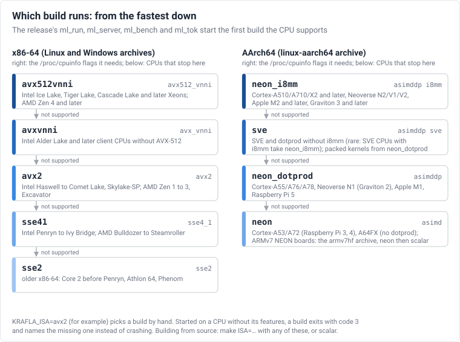
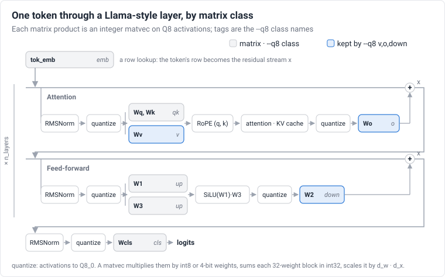
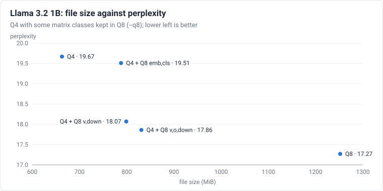

# User guide

This guide covers building Krafla, getting a model into the `.mlb` format, and
running it.

## Requirements

- A C11 compiler: GCC or Clang. For x86-64 you can also use MSVC through CMake.
- GNU Make.
- Python 3 with numpy, for the model tools. Install pytest as well if you want to
  run the test suite.
- For ARM cross builds: `gcc-aarch64-linux-gnu` or `gcc-arm-linux-gnueabihf`,
  plus `qemu-user` to run the results on an x86 host.

## Prebuilt binaries

Each [release](https://github.com/JonPark0/krafla/releases) has static
binaries for every ISA:

| Archive | Builds |
|---------|--------|
| `krafla-VER-linux-x86_64.tar.gz` | `sse2`, `sse41`, `avx2`, `avxvnni`, `avx512vnni` |
| `krafla-VER-linux-aarch64.tar.gz` | `neon`, `neon_dotprod`, `neon_i8mm`, `sve` |
| `krafla-VER-linux-armv7hf.tar.gz` | `neon`, `scalar` |
| `krafla-VER-windows-x86_64.zip` | `sse2`, `sse41`, `avx2`, `avxvnni`, `avx512vnni` |

The top-level `ml_run`, `ml_server`, `ml_bench` and `ml_tok` (`.cmd` on
Windows) try the builds in `bin/` from the fastest down and start the first
one the CPU supports. To choose a build yourself, set `KRAFLA_ISA`, for example
`KRAFLA_ISA=avx2`. The variable's old name, `ISA_LM_ISA`, still works. The
archives also hold the model tools `tools/convert.py`,
`tools/convert_tokenizer.py` and `tools/perplexity.py`, which need Python 3
with numpy.



`scripts/package_release.sh` builds the same archives locally, and
`scripts/smoke_release.sh` runs them. To cut a release, merge a version bump
into main that raises `ML_VERSION` in `core/ml.h` to X.Y.Z and renames
`## Unreleased` in `CHANGELOG.md` to `## X.Y.Z — date`. Before merging, run
`python3 scripts/sync_docs.py` to refresh the site's changelog page.
`.github/workflows/auto-release.yml` then sees the new version, and
`release.yml` builds and runs the archives, publishes release vX.Y.Z and
creates the tag on that commit. Pushing a tag vX.Y.Z also still works. CI
fails a pull request that raises `ML_VERSION` without adding its CHANGELOG
section. Zenodo archives each published release and gives it a DOI; the
concept DOI `10.5281/zenodo.23880653` resolves to the latest one. Once
Zenodo has minted the release's own DOI, `.github/workflows/zenodo-doi.yml`
adds it to the release notes (it reads Zenodo's public API, so it needs no
token; run it by hand for an older release).

Converted models are published on Hugging Face by
`.github/workflows/hf-models.yml`, which is run by hand. For each model in
`scripts/hf_models.json`, it uses that commit's tools to convert the Q4_0 and
Q8_0 files, the mixed file if the model has one, and the tokenizer. It then
measures them on the runner (wikitext-2 perplexity, `ml_bench` speed, one chat
reply) and writes the model card (`scripts/hf_publish.py`). With `upload` on,
it pushes them to `<account>/<model>-krafla`, using the repository secret
`HF_TOKEN`, and then brings the account's "Krafla" collection in line
(`.github/workflows/hf-collection.yml`, `scripts/hf_collection.py`): every
published model of the catalog, smallest first, each noted with the Krafla
version it needs, its `--chat` template and the size of its Q4_0 file.
`python3 scripts/hf_publish.py MODEL --text wiki.txt` does the same locally,
without uploading, and `python3 scripts/hf_collection.py --owner ACCOUNT
--dry-run` shows what the collection sync would change.

## Building

```sh
make ISA=<isa> [THREADS=1|pthread] [ASM=0|1] [CROSS=<prefix>] [DEBUG=1] [EXTRA_CFLAGS=...]
```

The build writes `ml_run`, `ml_server`, `ml_bench`, `ml_tok` and the test
binaries to `build/<isa>[-<arch>][-pt][-asm][-dbg]/`. Each set of options gets its own
directory, so object files built with different flags never mix.

### Choosing the ISA

| `ISA`          | Runs on                                    |
|----------------|--------------------------------------------|
| `scalar`       | anything with a C compiler                 |
| `sse2`         | every x86-64 CPU                           |
| `sse41`        | Intel Penryn/Nehalem and later, AMD Bulldozer and later |
| `avx2`         | Intel Haswell and later, AMD Zen and later |
| `avxvnni`      | Intel Alder Lake and later, AMD Zen 5      |
| `avx512vnni`   | Intel Cascade Lake, Ice Lake, Sapphire Rapids; AMD Zen 4 and later |
| `neon`         | ARMv7 with NEON (Cortex-A7, A9, A15 and others), any AArch64 |
| `neon_dotprod` | ARMv8.2 dotprod (Cortex-A55/A76 and later, Apple M1 and later, Graviton 2 and later) |
| `neon_i8mm`    | dotprod + int8 matrix multiply (Cortex-A510/A710/X2 and later, Neoverse N2/V1, Apple M2 and later, Graviton 3 and later) |
| `sve`          | SVE CPUs with dotprod (Neoverse V1/V2/N2, Graviton 3 and later; not A64FX, which lacks dotprod) |

To find what a Linux machine supports, run
`grep -o -w -E 'sse4_1|avx2|avx_vnni|avx512_vnni|asimddp|i8mm|sve' /proc/cpuinfo | sort -u`.

If you start a binary on a CPU that lacks its ISA, it exits with code 3
instead of crashing and names the missing feature:

```
error: CPU lacks avx512-vnni required by ISA=avx512vnni
```

### Cross builds

```sh
make ISA=neon CROSS=arm-linux-gnueabihf-                     # ARMv7 hard-float
make ISA=sve CROSS=aarch64-linux-gnu- test e2e               # runs under qemu-aarch64 -cpu max
make ISA=sve CROSS=aarch64-linux-gnu- QEMU_CPU=max,sve-max-vq=1 test   # SVE at 128 bits
```

Cross builds are linked statically, so qemu does not need a sysroot. When
`CROSS` targets another architecture, `make test` and `make e2e` run the
binaries through qemu automatically.

### CMake (x86-64, including MSVC)

```sh
cmake -S . -B build/cmake -DML_ISA=avx2 -DCMAKE_BUILD_TYPE=Release
cmake --build build/cmake && ctest --test-dir build/cmake
```

Set `-DCMAKE_BUILD_TYPE=Release` yourself; without it CMake builds without
optimization. The pthread pool (`-DML_THREADS=ON`) is not available with MSVC.

## Getting a model

### Converted models on Hugging Face

These models are converted and published by `.github/workflows/hf-models.yml`
(see [Prebuilt binaries](#prebuilt-binaries)), so you can use them without
installing Python. They are also gathered, smallest first, in the
[Krafla collection](https://huggingface.co/collections/jonpark0/krafla) on Hugging Face:

| Model | Q4_0 | Q8_0 | Perplexity Q4_0 / Q8_0 | `--chat` | Krafla |
|-------|-----:|-----:|---------------------:|----------|--------|
| [SmolLM2 135M Instruct](https://huggingface.co/jonpark0/SmolLM2-135M-Instruct-krafla) | 72 MiB | 136 MiB | 31.6 / 23.5 | `smollm` | 0.8.0 |
| [SmolLM2 360M Instruct](https://huggingface.co/jonpark0/SmolLM2-360M-Instruct-krafla) | 194 MiB | 367 MiB | 21.7 / 17.5 | `smollm` | 0.8.0 |
| [Qwen2.5 0.5B Instruct](https://huggingface.co/jonpark0/Qwen2.5-0.5B-Instruct-krafla) | 265 MiB | 501 MiB | 21.7 / 19.0 | `qwen` | 0.8.0 |
| [Qwen3 0.6B](https://huggingface.co/jonpark0/Qwen3-0.6B-krafla) | 320 MiB | 604 MiB | 31.7 / 27.9 | `chatml` | 0.8.0 |
| [Qwen3.5 0.8B](https://huggingface.co/jonpark0/Qwen3.5-0.8B-krafla) | 406 MiB | 764 MiB | 27.5 / 23.9 | `qwen3.5-nothink` | 0.9.0 |
| [TinyLlama 1.1B Chat](https://huggingface.co/jonpark0/TinyLlama-1.1B-Chat-v1.0-krafla) | 590 MiB | 1115 MiB | 10.6 / 10.3 | `zephyr` | 0.8.0 |
| [Qwen2.5 1.5B Instruct](https://huggingface.co/jonpark0/Qwen2.5-1.5B-Instruct-krafla) | 829 MiB | 1565 MiB | 14.7 / 12.7 | `qwen` | 0.8.0 |
| [Qwen3 1.7B](https://huggingface.co/jonpark0/Qwen3-1.7B-krafla) | 923 MiB | 1744 MiB | 24.0 / 21.0 | `chatml` | 0.8.0 |
| [Qwen3.5 2B](https://huggingface.co/jonpark0/Qwen3.5-2B-krafla) | 1012 MiB | 1908 MiB | 18.2 / 16.5 | `qwen3.5-nothink` | 0.9.0 |
| [SmolLM3 3B](https://huggingface.co/jonpark0/SmolLM3-3B-krafla) | 1650 MiB | 3116 MiB | 13.8 / 11.6 | `chatml` | 0.8.0 |
| [Qwen3 4B Instruct 2507](https://huggingface.co/jonpark0/Qwen3-4B-Instruct-2507-krafla) | 2158 MiB | 4076 MiB | 14.1 / 13.1 | `chatml` | 0.8.0 |
| [Qwen3.5 4B](https://huggingface.co/jonpark0/Qwen3.5-4B-krafla) | 2261 MiB | 4264 MiB | 13.3 / 12.2 | `qwen3.5-nothink` | 0.9.0 |
| [Qwen2.5 7B Instruct](https://huggingface.co/jonpark0/Qwen2.5-7B-Instruct-krafla) | 4086 MiB | 7718 MiB | 9.9 / 9.0 | `qwen` | 0.8.0 |
| [Qwen3 8B](https://huggingface.co/jonpark0/Qwen3-8B-krafla) | 4395 MiB | 8300 MiB | 13.1 / 12.5 | `chatml` | 0.9.0 |
| [Qwen3.5 9B](https://huggingface.co/jonpark0/Qwen3.5-9B-krafla) | 4810 MiB | 9076 MiB | 10.7 / 10.1 | `qwen3.5-nothink` | 0.9.0 |

Each repository holds the Q4_0 and Q8_0 files, `tokenizer.mlt`, `SHA256SUMS`
and a model card with the speed of each file. All but the two SmolLM2
repositories also hold a mixed file: Q4_0 with some matrices in Q8_0.
Perplexity is measured on wikitext-2 (4 chunks of 512 tokens) and is
comparable only between files of the same model. For SmolLM2, take the Q8_0
file. The files need the Krafla version in the last column or later. They
record the model's full context, of which `ml_run` and `ml_server` use 4096
positions unless you pass `--ctx N`. The Qwen3.5 models answer without
thinking with `qwen3.5-nothink`; `--chat qwen3.5` lets them think first.
Models by others with the `krafla` tag are listed at
<https://huggingface.co/models?other=krafla>.

```sh
curl -LO https://huggingface.co/jonpark0/Qwen2.5-0.5B-Instruct-krafla/resolve/main/Qwen2.5-0.5B-Instruct-Q4_0.mlb
curl -LO https://huggingface.co/jonpark0/Qwen2.5-0.5B-Instruct-krafla/resolve/main/tokenizer.mlt
./ml_run Qwen2.5-0.5B-Instruct-Q4_0.mlb -z tokenizer.mlt --chat qwen -t 4
```

### From a llama2.c checkpoint

```sh
python3 tools/convert.py llama2c stories15M.bin stories15M.mlb --wtype q8
```

Use the matching llama2.c `tokenizer.bin` as it is.

### From a Hugging Face checkpoint

The converter reads Llama (including SmolLM2), SmolLM3, Mistral, Qwen2
(Qwen2.5), Qwen3, Gemma 2 and Gemma 3 checkpoints. It takes a directory that
contains `config.json` and one or more `*.safetensors` files:

```sh
python3 tools/convert.py hf ./TinyLlama-1.1B model.mlb --wtype q4
```

- **Weight types:** F32, F16 and BF16 safetensors are supported.
- **Tied embeddings:** if the checkpoint has no `lm_head`, the file is written
  with a shared classifier.
- **Rotary layout:** the q/k projections are permuted from the Hugging Face
  rotate-half layout to the interleaved pairs the runtime uses.
- **RoPE scaling:** `rope_scaling` of type `llama3` (Llama 3.1 and 3.2),
  `linear` and `yarn` (for example Qwen2.5 and Qwen3 beyond 32K tokens, as
  their model cards describe) are supported, with transformers' formulas. The
  converter refuses other types (dynamic, longrope) instead of writing a model
  that would compute wrong outputs.
- **Architectures:** `model_type` must be `llama`, `mistral`, `qwen2`, `qwen3`,
  `qwen3_5` (Qwen3.5 and Qwen3.6, dense), `smollm3`, `gemma2`, `gemma3_text`
  (Gemma 3 1B) or `gemma3` (Gemma 3 4B, 12B and 27B). SmolLM3 leaves out RoPE
  in every fourth layer (`no_rope_layers`); the converter marks those layers.
  Qwen3.5 puts three linear-attention layers (the gated delta rule) before
  every attention layer, gates the attention output and rotates a quarter of
  each head; the converter takes its language model and leaves out the vision
  tower and the multi-token prediction head. Its `(1 + w)` norm weights are
  stored with the 1 added, and the linear layers' `b` and `a` projections stay
  in Q8_0 in every file.
  The `gemma3` checkpoints are image-text models: the converter takes the text
  model and leaves the vision tower out. Biases are accepted only on Qwen2's
  q, k and v projections. Supported features: a `head_dim` other than
  `hidden_size / num_attention_heads`; Qwen3's per-head q/k RMSNorm; for
  Gemma, GELU, block output norms, embedding and attention scales, and
  local/global layers; and Gemma 2's soft-capping of attention scores and
  logits. Gemma's `(1 + w)` norm weights are stored with the 1 added. Other
  architectures, such as Phi and mixture-of-experts models, are refused.
- **Memory:** tensors are converted to float32 one at a time, so converting a
  4B model needs about as much memory as its largest tensor.
- **Sliding window:** in a sliding-window layer, each position attends to the
  last `sliding_window` positions. Every layer of Mistral v0.1 is one; in
  other models, `layer_types` or Qwen2's `max_window_layers` selects which
  layers are.
- **Context length:** the file records the longest context the model allows,
  `max_position_embeddings` (often 131072 for Llama 3), or less with
  `--max-seq`. The KV cache is sized when the model runs, by `--ctx`.
- **Scales:** each block's scale is stored as `f16` by default (Q4_0 at 4.5
  bits per weight, Q8_0 at 8.5). `--scales f32` keeps the older 4-byte scales
  (5 and 9 bits per weight). With f32 scales every file is 5–10% larger, and
  perplexity changes by at most 0.15%. Files of both kinds load in every
  build.
- **Tokenizer:** convert the checkpoint's `tokenizer.json` separately, see
  [Tokenizers](#tokenizers).

### Tokenizers

`ml_run -z` reads either a llama2.c `tokenizer.bin` or an `.mlt` file
converted from a Hugging Face `tokenizer.json`:

```sh
python3 tools/convert_tokenizer.py ./Llama-3.2-1B-Instruct/tokenizer.json llama3.mlt
printf "Hello, world" | build/avx2/ml_tok llama3.mlt        # 128000 9906 11 1917
echo "9906 11 1917" | build/avx2/ml_tok llama3.mlt --decode          # Hello, world
```

These kinds are supported, and they encode exactly as the Hugging Face
`tokenizers` library does (the tests compare them on hundreds of texts):

| Kind | Models | Notes |
|------|--------|-------|
| SentencePiece-style BPE with byte fallback | Llama 2, TinyLlama, Mistral, Vicuna, Gemma 3 | spaces become `▁` (Gemma adds none before the text), characters outside the vocabulary become `<0xXX>` byte tokens |
| byte-level BPE with the Llama 3 pre-tokenizer | Llama 3, 3.1, 3.2 | text is split by the Llama 3 regex (letters, numbers, contractions, white space) before merging |
| byte-level BPE with NFC and the Qwen2 pre-tokenizer | Qwen2, Qwen2.5, Qwen3 | text is normalized to NFC, then split as Llama 3 but with one digit per number chunk |
| byte-level BPE with NFC and the Qwen3.5 pre-tokenizer | Qwen3.5, Qwen3.6 | as Qwen2, with combining marks (`\p{M}`) kept with the letters |
| byte-level BPE with the GPT-2 pre-tokenizer | SmolLM, SmolLM2, GPT-2 | text is split by the GPT-2 regex, after splitting off every digit if the tokenizer does (SmolLM2) |

The converter refuses anything else (WordPiece, Unigram, other normalizers or
pre-tokenizers) rather than write a tokenizer that would encode differently.

- **BOS:** added when the tokenizer's template adds it (`<s>`,
  `<|begin_of_text|>`); Qwen2, Qwen3 and SmolLM2 add none.
- **Special tokens** written in the prompt, such as `<|eot_id|>`, are encoded
  as the special tokens.
- **Stopping:** without `--chat`, generation stops at the tokenizer's BOS or
  EOS (the EOS is, for example, `</s>` or `<|end_of_text|>`). Instruct models
  often end a turn with another token: pass it with `--eos` to stop there
  instead, for example `--eos 128009` (`<|eot_id|>`) for Llama 3 Instruct.

### Chat

`--chat TEMPLATE` wraps each message in the model's chat template, keeps the
conversation in the KV cache, and stops each reply at the template's end
token:

```sh
build/avx2/ml_run llama3.mlb -z llama3.mlt --chat llama3 --system "You are a helpful assistant." -t 4
> What is the capital of France?
The capital of France is Paris.
> And of Germany?
The capital of Germany is Berlin.
```

| Template | Models | Reply ends at |
|----------|--------|---------------|
| `llama3` | Llama 3, 3.1, 3.2 Instruct | `<|eot_id|>` |
| `zephyr` | TinyLlama Chat, Zephyr | `</s>` |
| `llama2` | Llama 2 Chat, Mistral Instruct (without `--system`) | `</s>` |
| `qwen` | Qwen2.5 Instruct; without `--system` it uses Qwen's default system prompt | `<|im_end|>` |
| `smollm` | SmolLM2 Instruct; without `--system` it uses SmolLM2's default system prompt | `<|im_end|>` |
| `gemma` | Gemma 3 Instruct; `--system` goes at the start of the first user turn | `<end_of_turn>` |
| `chatml` | Qwen3, SmolLM3 and other ChatML models; a system turn only with `--system` | `<|im_end|>` |
| `qwen3.5` | Qwen3.5 and Qwen3.6 with reasoning: ChatML, the reply opened with `<think>` (the default of their 4B and larger templates) | `<|im_end|>` |
| `qwen3.5-nothink` | Qwen3.5 and Qwen3.6 without reasoning: ChatML, the reply after an empty think block (the default of the 0.8B and 2B templates) | `<|im_end|>` |

Qwen3 writes a `<think>...</think>` section before it answers. Ending a
message with `/no_think` asks it to skip the reasoning. The KV cache keeps
earlier replies with their reasoning, whereas Qwen3's own template drops it
from the history.

Type one turn per line on stdin (a `> ` prompt appears on a terminal), or pass
a single turn with `-i`; end with Ctrl-D. `-n` caps each reply; without it a
reply may use the rest of the context (`--ctx`), and when the context is full
`ml_run` prints a message and ends the conversation. `-T`, `-p`, `--top-k` and
`--repeat-penalty` apply as usual.

Without `--chat`, write the template yourself with `-i` and stop with `--eos`
(see [Tokenizers](#tokenizers)).

### A random test model

```sh
python3 tools/gen_random.py --out rand.mlb --wtype q4 --dim 256 --layers 4 --vocab 512
python3 tools/gen_tokenizer.py --vocab 512 --out tok.bin
```

### Q8, Q4, or mixed?

The converter writes weights in two formats. In the rest of this guide, "Q8"
and "Q4" are short for `Q8_0` and `Q4_0`:

| Format | Bits per weight | Notes |
|--------|-----------------|-------|
| `Q8_0` | 8.5 (9 with `--scales f32`) | close to F32 quality |
| `Q4_0` | 4.5 (5 with `--scales f32`) | about half the memory traffic of Q8_0, so faster decoding; costs some quality |

Choose Q8 for accuracy and Q4 for size. In between, `--q8` keeps some matrix
classes of a Q4 model in Q8 (`emb`, `cls`, `qk`, `v`, `o`, `up`, `down`):



A tied embedding (Qwen2.5 0.5B, Llama 3.2 1B, SmolLM2, Gemma 3) is also the
classifier, so `--q8 emb` or `--q8 cls` keeps it in Q8. In Qwen3.5's
linear-attention layers, `lqkv` and the attention gate take the class `qk`,
`lz` takes `v` and `lout` takes `o`; their two small gates are always Q8.

```sh
python3 tools/convert.py hf ./Llama-3.2-1B-Instruct llama.mlb --wtype q4 --q8 v,o,down
```

Perplexity of Llama 3.2 1B on 2044 tokens of wikitext-2, measured with
`tools/perplexity.py`. All files use f16 scales (the converter's default);
sizes are in MiB. Decode speed is on 4 vCPUs with the avx512vnni build.

| Weights | Size | Perplexity | Decode `-t 4` |
|---------|-----:|-----------:|--------------:|
| Q8 | 1252 MiB | 17.27 | 35.0 tok/s |
| Q4 + Q8 `v,o,down` | 831 MiB | 17.86 | 47.7 tok/s |
| Q4 + Q8 `v,down` | 799 MiB | 18.07 | |
| Q4 + Q8 `emb,cls` | 788 MiB | 19.51 | |
| Q4 | 663 MiB | 19.67 | 64.1 tok/s |



The down projection (`down`) and the value and output projections (`v`, `o`)
matter most: keeping them in Q8 recovers three quarters of the gap to Q8 for
under a third of its extra size. The embedding and classifier (`emb`, `cls`)
are large for a 128K vocabulary and help little. The Q8 KV cache costs nothing
measurable here: `--kv q8` on the Q8 model gives 17.27.

Qwen2.5 0.5B Instruct on the same text and machine. Qwen2.5 adds no BOS, and
the F32 numpy reference scores 19.00:

| Weights | Size | Perplexity | Decode `-t 4` |
|---------|-----:|-----------:|--------------:|
| Q8 | 500 MiB | 18.98 | 87.3 tok/s |
| Q4 + Q8 `emb,v,o,down` | 390 MiB | 20.06 | 107.2 tok/s |
| Q4 | 265 MiB | 21.74 | 141.5 tok/s |

Small models lose more to Q4: here `up` and `down` matter most, then `v`.

The converter fits each Q4 block's scale by weighted least squares over a few
candidate mappings, rather than dividing the block's maximum by 7, as earlier
versions of the converter did (Llama 3.2 1B Q4: 19.91 instead of 20.46;
Qwen2.5 0.5B: 21.74 instead of 23.58). The file format and the kernels are
unchanged, so older Q4 files still load; convert again to get the better
scales. See [the quantization rule](file-format.md#quantization-rule).

Other models on the same text, all with f16 scales. The F32 column is the
numpy reference, and the Q4 column uses the converter's default rule for
each model (see below):

| Model | F32 | Q8 | Q4 |
|-------|----:|---:|---:|
| Qwen3 0.6B | 28.10 | 27.90 | 31.69 |
| SmolLM2 135M Instruct | 23.44 | 23.62 | 31.25 |
| Gemma 3 1B Instruct | 42.32 | 41.97 | 49.83 |
| Gemma 3 4B Instruct | — | 24.30 | 23.31 |

For Gemma 3 4B, the F32 reference was not run over the whole text. On its
first 96 tokens, the Q8 logits are within KL 0.0021 of it, with the same
argmax at 97% of the positions. Its Q8 file takes 3932 MiB and its Q4 file
2083 MiB.

Gemma 3 1B loses the most to Q4: with the fit its perplexity rises to 53.25,
and keeping `emb,cls,v,down` in Q8 brings it to 47.97 at 783 MiB. llama.cpp's
plain Q4_0 rounding (`--q4-rule round`) does better on Gemma 3 (49.83 at
536 MiB), though not on the other models in the table below. Google's
quantization-aware checkpoint (`gemma-3-1b-it-qat-q4_0-unquantized`) was
trained for exactly that rounding; rounded, it scores 40.50 at 536 MiB, below
its own Q8 (42.53) and below the regular checkpoint's F32 reference. The fit
gives 47.43 on it. The converter therefore rounds Gemma 3 checkpoints by
default.

Llama-architecture checkpoints (`model_type` `llama`: Llama 3.2, TinyLlama,
SmolLM2) get a third rule, `flat`. It is the fit with each weight's error
weighted by `sqrt(s2 + x²)`, where `s2` is the row's mean x², as llama.cpp
weights its importance search when every channel counts the same. On seven
such models it came closer to the unquantized model than the plain fit on
all seven, and than llama.cpp's rounding on six
([Q4_0 block scales](q4-scales.md#llama-architecture-models)). The other
models are fitted by x². `--q4-rule fit|flat|round` overrides the choice.

| Q4 rule (f16 scales) | Qwen2.5 0.5B | Llama 3.2 1B | Qwen3 0.6B | SmolLM2 135M | Gemma 3 1B | Gemma 3 1B QAT |
|---|---:|---:|---:|---:|---:|---:|
| fit | **21.74** | 19.91 | **31.69** | 31.60 | 53.25 | 47.43 |
| flat | 22.25 | **19.67** | 33.11 | **31.25** | — | — |
| round | 22.45 | 19.94 | 31.75 | 32.31 | **49.83** | **40.50** |

On these 2044 tokens `flat` loses to the fit on both Qwen models. Over 8,160
tokens it is ahead in KL divergence on three of the four Qwen models measured
(Qwen3 0.6B: perplexity 21.49 against 21.70 with `tools/perplexity.py
--llama-cpp`), but 14% behind on Qwen3 1.7B, so Qwen keeps the fit.

An importance matrix (`--imatrix`) tells the fit which weights matter most.
It records how large each input channel's activations are on sample text, and
the fit then quantizes the weights that multiply large activations more
precisely. Collect it with `ml_run --imatrix` on a Q8 conversion of the same
model (each run adds to the file), then convert to Q4 with it:

```sh
python3 tools/convert.py hf ./Qwen2.5-0.5B-Instruct q8.mlb --wtype q8
python3 tools/perplexity.py build/avx2/ml_run q8.mlb tok.mlt sample.txt --ml-tok build/avx2/ml_tok \
    --ctx 512 --chunks 32 --extra "--imatrix qwen.imat"
python3 tools/convert.py hf ./Qwen2.5-0.5B-Instruct q4.mlb --wtype q4 --imatrix qwen.imat
```

A tied embedding (Qwen2.5, Llama 3.2) is also the classifier and takes the
classifier's importance; an untied one is only a lookup and keeps the plain
fit. Q8 matrices ignore the importance matrix.

Perplexity of Qwen2.5 0.5B Instruct Q4 on the wikitext-2 test set, measured
with `tools/perplexity.py --ctx 512`. The importance matrix was collected on
the first 32K tokens of the wikitext-2 training set (`--chunks 64`):

| Weights | 4 chunks | 16 chunks | `--llama-cpp`, 4 chunks |
|---------|---------:|----------:|------------------------:|
| Q8 | 19.01 | 22.10 | 13.33 |
| Q4 | 21.72 | 26.47 | 15.13 |
| Q4 `--imatrix` | 20.92 | 25.30 | 14.52 |

It closes a quarter to a third of the gap to Q8. The gain depends on the
sample text: an importance matrix collected on TinyStories gives 25.74 on 16
chunks. Collect it on text similar to what the model will be used for.

## Running

```sh
build/avx2/ml_run model.mlb -z tokenizer.bin -i "Once upon a time" -n 128 -T 0.8 -p 0.9
build/avx2/ml_run model.mlb --tokens 1,450,3681 -n 32            # ids in, ids out
build/avx2/ml_run model.mlb --tokens 1,450,3681 --dump-logits l.f32
```

| Option | Meaning |
|--------|---------|
| `-z FILE` | Tokenizer: llama2.c `tokenizer.bin`, or `.mlt` from `tools/convert_tokenizer.py`. Needed for `-i` and for text output. |
| `-i TEXT` | Prompt text. Encoded with BOS. |
| `--tokens LIST` | Prompt as comma-separated token ids. Each id must be below `vocab`. |
| `-n N` | Positions to run, prompt included. Default 64; capped at `--ctx`. |
| `--ctx N` | Context length: the positions the KV cache holds, from 1 to the file's `max_seq`. Default `max_seq`, but at most 4096, so that a file converted at the model's full context (128K positions for Llama 3.1) does not reserve gigabytes of KV cache unless asked to. Logits do not depend on it. |
| `-T F` | Temperature. `0` means greedy decoding (ties go to the lowest id). Default 0. |
| `-p F` | Top-p in [0, 1]. Values of 0 or 1 sample from the full distribution. Default 0.9. |
| `--top-k N` | Sample only from the `N` most likely tokens, then apply top-p among them. `0` (default) turns it off; `1` is greedy at any temperature. |
| `--repeat-penalty F` | Repetition penalty: divide the positive logit of each token seen in the last `--repeat-last-n` tokens by `F` and multiply a negative one, as Hugging Face does. Applies to greedy decoding too. `1` (default) turns it off; 1.1–1.3 is typical. |
| `--repeat-last-n N` | How many recent tokens, prompt included, the penalty looks at. Default 64. |
| `-s N` | Seed for the xorshift64* RNG. Default 1. |
| `-t N` | Threads, 1 to 64. Only builds made with `THREADS=pthread` use more than one. |
| `--dump-logits F` | Write float32 logits `[n_tokens][vocab]` for every `--tokens` position, then exit. |
| `--batch N` | Prompt tokens per batched prefill step, 1 to 128. Default 128; `1` processes the prompt token by token. The output is identical either way. |
| `--kv TYPE` | KV cache type: `f32` (default), `f16` or `q8`. `f16` rounds K and V to half precision: half the memory at the same speed, and perplexity 21.71 against 21.74 for Qwen2.5 0.5B Q4. `q8` stores K and V as int8 with one scale per position and KV head. It uses about 3.8× less memory and speeds up attention on long contexts, but raises perplexity on the same test to 22.82. |
| `--pack-cache` | Save the packed weights next to the model (`MODEL.pk<G>`, G = pack group) and map them from there on later runs instead of packing again. The cache is checked against the model and the build's layout and rewritten when stale. |
| `--no-pack` | Keep weights row-major instead of repacking them for the packed kernels. Uses less memory during load, but runs slower. |
| `--profile` | Print the share of forward-pass time per stage (qkv, attention, wo, ffn, classifier, other). |
| `--chat TEMPLATE` | Chat with the model: `llama3`, `zephyr`, `llama2`, `qwen`, `smollm`, `chatml`, `gemma`, `qwen3.5` or `qwen3.5-nothink`, see [Chat](#chat). Needs `-z`. |
| `--system TEXT` | System prompt for `--chat`. |
| `--eos ID` | Stop as soon as `ID` is generated. Without it, a run with `-z` stops at the tokenizer's BOS or EOS, and a run without `-z` uses every `-n` position. |

To serve a model to other programs over HTTP with the OpenAI API, use
`ml_server` instead; see [Server](server.md).

When it finishes, `ml_run` prints two lines to stderr:

- `prefill: P tokens in M ms (R tok/s)`, when the prompt has more than one
  token;
- `positions: N, tok/s: X, threads: T, isa: I, packed: G, kv: K`, where `G` is
  the pack group the weights were repacked to, or 0, and `K` the KV cache type.

Exit codes:

| Code | Meaning |
|------|---------|
| 0 | success |
| 1 | load or runtime error (bad file, out of memory) |
| 2 | usage error |
| 3 | the CPU lacks the ISA the binary was built for |

### Threads

Build with `THREADS=pthread` and pass `-t N`. The pool waits by spinning
briefly, then sleeps, so consecutive operations within a token cost no system
calls. Matrix-vector products smaller than 2^18 weights, and small attention
steps, run on the calling thread only.

On a 4-vCPU VM with the avx512vnni build, `-t 4` decodes a Q4 model with 4
layers and dim 2048 at 503 tok/s, against 140 tok/s for `-t 1`. Threading
never changes the output: `-t N` produces logits bit-identical to `-t 1`.

### Performance notes

- **Q4 or Q8:** prefer Q4 on large models. Decoding is limited by memory
  bandwidth, and Q4 moves 45% fewer bytes. With packed kernels, Q4 is the
  faster format on every ISA that has them.
- **Prefill:** long prompts are prefilled in batches of 128 tokens, which is
  2–6× faster than token by token, depending on the ISA and the model size.
- **Long contexts:** attention grows with the position and, past a few
  thousand tokens, takes a third or more of the time. `--kv f16` halves the
  KV cache at no measurable cost; `--kv q8` cuts its size and memory traffic
  by about 3.8×, at some cost in perplexity (see `--kv`).
- **Memory:** packing makes one copy of the weights at load, a matrix at a
  time, releasing each original's pages as it goes, so the peak is about the
  model plus its largest matrix. With `--no-pack` there is no copy at all, and
  `--pack-cache` maps a copy saved by an earlier run.
- **Start-up:** packing takes time at every start: 1.8 s for Llama 3.2 1B Q4
  on one core (0.7 s with `-t 4`). With `--pack-cache` later starts map the
  packed weights directly and take 0.13 s, at the cost of a second copy on
  disk.

## Limits

- **Dimensions:** `dim`, `hidden_dim`, `n_layers` and head counts can be at most
  65536. `vocab` and `max_seq` can be at most 2^24.
- **Shapes:** `dim` and `hidden_dim` must be multiples of 32, `head_dim` must be
  even, and `n_heads` must be a multiple of `n_kv_heads`.
- **Memory:** the KV cache uses `n_layers × ctx × kv_dim × 8` bytes,
  `n_layers × ctx × kv_dim × 4` with `--kv f16`, or
  `n_layers × ctx × (kv_dim + 4 × n_kv_heads) × 2` with `--kv q8`, where `ctx`
  is `--ctx`. All size
  arithmetic is overflow-checked, so on 32-bit ARMv7 an oversized model fails
  with `out of memory` instead of crashing.
- **Architecture:** Llama-family decoders (Llama, Mistral, Qwen2, Qwen3,
  SmolLM3), Gemma 2 and 3, and Qwen3.5's hybrid of linear attention and
  attention: RMSNorm, SwiGLU or GELU, GQA, RoPE (on part of each head, or
  none in chosen layers), biases only on the q, k and v projections (Qwen2),
  optional per-head q/k RMSNorm (Qwen3), block output norms and soft-capping
  (Gemma), a sliding window and a second RoPE base for chosen layers, and the
  gated delta rule with a gated attention output (Qwen3.5).
  `tools/convert.py` refuses other architectures, including mixture of
  experts (Qwen3.5 35B-A3B and larger).
- **Linear attention:** a linear-attention layer keeps a fixed state instead
  of a KV cache, which cannot be rewound: a run that does not continue the
  last one starts over from position 0. `ml_server` reuses a previous request
  only when the new prompt continues all of it.
